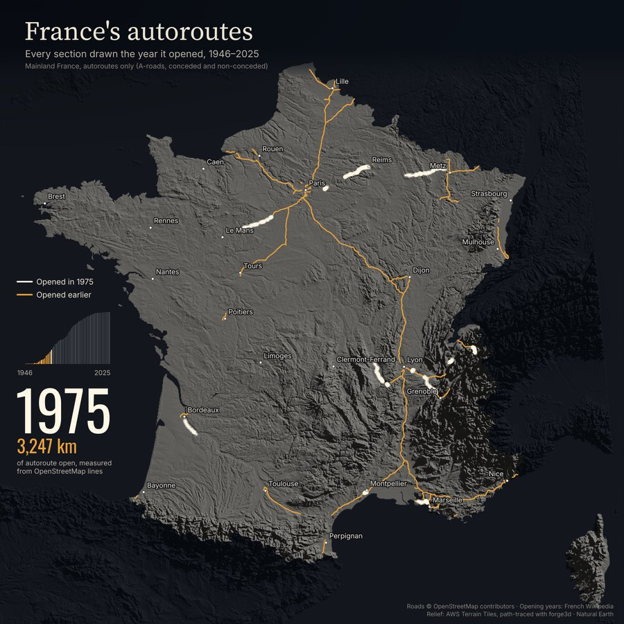
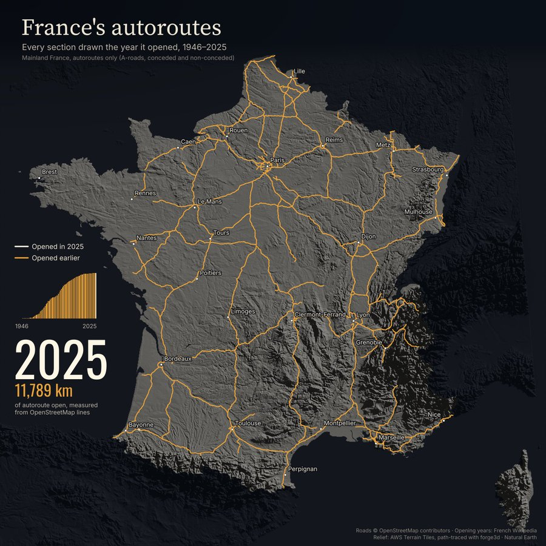

# France's autoroutes, 1946–2025

Every section of mainland France's motorway network, drawn the year it opened, rendered as a dark relief map and an animated MP4.
Inspired by Milos Popovic's forge3d map of Japan's expressways.

| 1975 | 2025 |
|---|---|
|  |  |

## Run it

Python 3.10+ (Windows PowerShell shown; same on macOS/Linux):

```powershell
git clone https://github.com/sofia2027/france-autoroutes-network.git
cd france-autoroutes-network
pip install -r requirements.txt

python 01_network.py                  # all years: PNG frames + MP4 in .\output
python 01_network.py --year 1980      # one map: .\output\network_1980.png
python 01_network.py --size 1080 --spy 0.4   # 1080 px video, 0.4 s per year
```

Options: `--year`, `--size` (default 1440), `--spy` seconds per year (default 0.32), `--out` output folder.
ffmpeg is bundled through `imageio-ffmpeg`, nothing else to install.

## How it was made

1. **Roads**: OpenStreetMap `highway=motorway` ways in France (Overpass API), clipped to the mainland, projected to Lambert-93.
2. **Opening years**: section-by-section dates from French Wikipedia ("mise en service"), matched to the OSM ways by
   corridor between section end points; OSM `start_date` tags fill gaps; remaining gaps inherit from connected ways.
3. **Relief**: AWS Terrain Tiles mosaic at ~600 m, top-down orthographic, path-traced with
   [forge3d](https://github.com/milos-agathon/forge3d) (`render_terrain_poster`), then graded dark.
4. **Frames**: matplotlib, one per year (white = opened that year, amber = earlier), stitched with ffmpeg.

Total length counts each road once (dual carriageways halved): 11,789 km, against INSEE's 11,751 km for 2023 (+0.3%).

## Data and licences

Code: MIT. Data: © OpenStreetMap contributors (ODbL), French Wikipedia (CC BY-SA), AWS Terrain Tiles, Natural Earth.
Fonts: SIL OFL. Details in [DATA_LICENSE.md](DATA_LICENSE.md).
